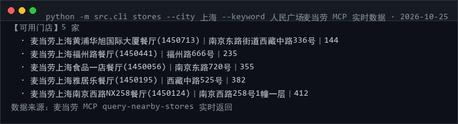

# 🧭 mcd-store-truth · 麦当劳到店真相（确定性校验器）

> 🌐 **在线展示页**：https://susevenci.github.io/mcd-store-truth/（GitHub Pages，含真实运行截图；仓库地址见文末）

> ⭐ **觉得有用就点个 Star** —— 本项目正在参加麦当劳程序员创意开发大赛，排名唯一依据就是 Star 数。**零依赖、可离线运行，无需 Token 也能验证。**


> **这张券，在这家店，此刻，到底能不能用？**
> 本项目不给你"可能可以"，只给三种答案：**可以用 / 用不了 / 判不了**——并且每条结论都附上依据字段。

**核心立场：不许猜。**
麦当劳的券体系很碎（到店券、外送券、门店专属券、品类券、时段券），字段还会缺失。
绝大多数"不愉快"来自：你以为能用 → 柜台说不能。与其给一个可能错的答案，不如老实说"判不了，缺 XX 字段"。

```
$ python -m src.cli matrix --offline

【券 × 门店 真值矩阵】5 张券 × 3 家门店
券 \ 门店                  3450101     3450102     3450103
示例-麦旋风5折券(全渠道)        ✅           ✅           ✅
示例-门店专属咖啡券            ✅           ❌           ✅
示例-外送满减券               ❌           ❌           ❌
示例-过期汉堡券               ❌           ❌           ❌
示例-字段不全的神秘券           ❓           ❓           ❓

统计：✅ 可以用 5　❌ 用不了 7　❓ 判不了 3
```

> 上面用的是**本地示例数据**（文件名与文件头均已标注）。装上 Token 后换成实时数据，逻辑完全一致。

---

## 🔴 实时实测（2026-10-25，真实 MCP 调用）

```
$ python -m src.cli stores --city 上海 --keyword 人民广场
【可用门店】5 家
  · 麦当劳上海黄浦华旭国际大厦餐厅(1450713)｜南京东路街道西藏中路336号｜144
  · 麦当劳上海福州路餐厅(1450441)｜福州路666号｜235
  · 麦当劳上海食品一店餐厅(1450056)｜南京东路720号｜355
  · 麦当劳上海雅居乐餐厅(1450195)｜西藏中路525号｜382
  · 麦当劳上海南京西路NX258餐厅(1450124)｜南京西路258号1幢一层｜412
数据来源：麦当劳 MCP query-nearby-stores 实时返回
```

```
$ python -m src.cli coupons
[warn] 券返回为空，回落样例
【我的券】5 张　（示例数据）
数据来源：本地样例 coupons_sample.json（数值为示例）
```



**注意第二段 —— 这不是 bug，是设计。** 该账号当前卡包里确实没有券，
本项目**不会为了演示好看而编造券数据**，而是：明确打 warn、标明数据来源是本地样例、
让用户一眼看出哪部分是真的。真数据部分（门店）与样例部分（券）在输出里始终可区分。

`matrix` 会把实时门店与回落样例拼成矩阵，所以你在 README 里看到的矩阵
**门店列是真实的，券行是示例的** —— 报告头部的"数据来源"会如实写明。

> 实测结论：`beType=1`（到店自取）下上海人民广场附近返回 5 家营业门店，
> 含 `businessStartTime/businessEndTime` 与 `reservationTimeOptions` 字段，
> 后者正是"这家店现在能不能接待我"的关键证据。

---

## 为什么做这个

大多数麦当劳 MCP 作品都在做"帮我省钱""推荐套餐"，但真实世界里更戳心的是第三个问题：

| 场景 | 现在的体验 | 本项目 |
|---|---|---|
| 卡包里有 8 张券，走进一家店 | 到柜台才知道哪张能用 | 出门前跑一遍 `matrix`，全知道 |
| 这张券为什么用不了？ | 没人告诉你原因 | 逐条列出硬证据：渠道不匹配 / 门店不在清单 / 已过期 |
| 券的适用门店字段没返回 | 有的工具直接当"能用" | 本项目判 `❓ UNKNOWN`，并说明缺哪个字段 |
| 我该去哪家店才能把这张券花掉？ | 挨个试 | `matrix` 一列就看清哪几家 ✅ |

**和三档处事哲学**：宁可输出一个"判不了"，也不输出一个可能让你白跑一趟的"可以"。

---

## 三态判定规则（`src/store_engine.py`）

| 状态 | 触发条件 | 证据要求 |
|---|---|---|
| ✅ **TRUE 可以用** | 无任何 blocker，且无缺失关键字段 | 列出每条通过的字段（有效期 / 渠道 / 门店清单 / 状态） |
| ❌ **FALSE 用不了** | 命中任一硬证据 | 渠道不匹配、门店不在清单、已过期、未生效、状态异常 |
| ❓ **UNKNOWN 判不了** | 有缺失字段且无硬证据 | 明确写出缺什么：生效时间 / 失效时间 / 适用渠道 / **适用门店清单** |

> **硬证据优先**：一张既过期又字段残缺的券，判 FALSE 而不是 UNKNOWN（有单测守着）。

还有一个容易踩的细节：**「适用门店清单」字段缺失 ≠ 全门店可用**。
很多券带有限门店属性，服务端若不返回该字段，本项目一律判 `❓`，并提示"以 `calculate-price` 核价结果为准"。

---

## 安装

```bash
git clone https://github.com/susevenci/mcd-store-truth.git
cd mcd-store-truth           # 零依赖，Python 3.8+，无需 pip install
python -m src.cli matrix --offline    # 立刻看效果
```

真实数据：

```bash
cp .env.example .env         # 填入 MCD_MCP_TOKEN
python -m src.cli selfcheck
python -m src.cli stores --city 成都 --keyword 春熙路
python -m src.cli coupons
python -m src.cli matrix --city 成都 --keyword 春熙路
```

## 命令

| 命令 | 作用 |
|---|---|
| `stores` | 查门店（`--scenario pickup / drivethrough`） |
| `coupons` | 查我持有的券（合并 my-coupons + store-coupons 两条来源） |
| `verify --coupon X --store CODE` | 单张券的逐条证据校验 |
| `matrix` | 券 × 门店 全量真值矩阵 + 统计 |
| `selfcheck` | Token 自检 |

全部支持 `--json`；`matrix` 支持 `--today` 覆盖当天日期（便于回归测试）。

```
$ python -m src.cli verify --coupon 门店专属 --store 3450102 --offline

【确定性校验】示例-门店专属咖啡券 @ 示例-太古里得来速餐厅(3450102)
场景：pickup　结论：❌ 用不了
  ✅ 活动期内：生效日 2026-01-01 ≤ 今日 2026-10-25
  ✅ 未过期：失效日 2026-12-31 ≥ 今日 2026-10-25
  ✅ 渠道匹配：券=pickup，本次场景=pickup
  ❌ 门店不在适用清单内：门店=3450102，清单=2 项
```

---

## MCP 使用速览

| Tool | 用途 |
|---|---|
| `query-nearby-stores` | 到店/得来速门店列表（storeCode、beCode） |
| `query-my-coupons` | 卡包中的券 |
| `query-store-coupons` | **门店专属券**（最常被漏掉的一条来源） |
| `calculate-price` | 最终核价——所有"可以用"都要回到这里 |
| `query-meal-assistance` | 团餐助餐服务可用性（可选扩展） |

详见 [MCP_INTEGRATION.md](./MCP_INTEGRATION.md)。

## 真实性对照表

| 内容 | 状态 | 说明 |
|---|---|---|
| 三态判定逻辑 | ✅ 真实 | 13 项离线单测覆盖，含"硬证据优先于未知"等边界 |
| 渠道/门店/有效期判定 | ✅ 真实 | 全部依据服务端返回字段，不含猜测 |
| `samples/*.json` | 🟡 示例数据 | 字段名对齐真实接口，**storeCode 与券均为示意值** |
| 上面的终端输出 | 🟡 离线样例 | 实时数据会给出不同矩阵 |
| "可以用"的最终性 | ⚠️ 以核价为准 | 本项目减少白跑，**最终能否核销以官方实时结果为准** |

## 参赛合规自查

| 官方要求 | 本仓库 |
|---|---|
| README / CONTEST_DECLARATION / MCP_INTEGRATION / workbuddy / 示例配置 | ✅ |
| 无真实 Token | ✅ 仅环境变量，`.gitignore` 排除 `.env` |
| 无作弊刷榜 | ✅ |
| 内容合规 | ✅ 无贬损品牌表述；不使用"陷阱/注水券"一类负面词 |

## 测试

```bash
python -m unittest discover -s tests -p "test_*.py"   # 13 项，无需 Token
```

关键断言：空渠道字符串不得误判、`availableTimes` 式推断不存在、有硬否决时必须为 FALSE、字段缺失必须落 UNKNOWN。

## 免责

参赛作品，非麦当劳官方产品。券的适用性以麦当劳官方渠道实时结果为准。

MIT © 2026

---
## 作者的另外三个参赛作品
- [麦麦安心点](https://github.com/susevenci/mcd-safe-order) —— 特殊人群的麦当劳安全点餐三档筛查（儿童/老人/孕产/减脂/控钠控糖/素食）
- [麦门抽奖情报局](https://github.com/susevenci/mcd-prize-radar) —— 积分抽奖体检：能不能抽、还差多少分、奖池有什么、攒分路径在哪
- [麦门周报](https://github.com/susevenci/mcd-moments) —— 把麦当劳订单编译成可分享的单文件 HTML 年报

> 四个项目均已报名（报名 Issue #1342–#1345），同样参加「麦当劳程序员创意开发大赛 · 1024 程序员节」。如果这个项目帮到了你，欢迎去给另外几个也点上 Star。
